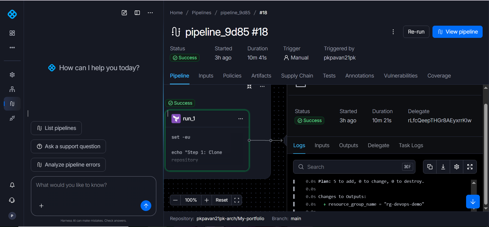
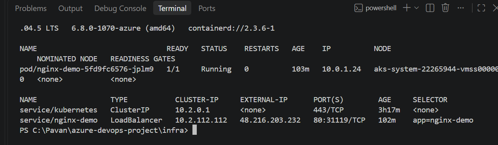
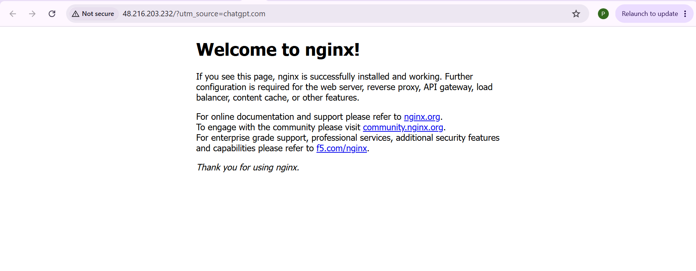

# Harness + Terraform Azure Infrastructure — Evidence

This page documents the implementation and runtime evidence for the portfolio project.

## Project summary

- Harness pipeline provisions Azure infrastructure with modular Terraform.
- Azure resources created for the lab include a resource group, virtual network, subnet, Azure Container Registry (ACR), and Azure Kubernetes Service (AKS).
- The Harness application-deployment pipeline applies Kubernetes manifests to AKS and verifies rollout, pods, service, and external IP.
- NGINX was verified running on AKS and exposed using a Kubernetes LoadBalancer service.

## Harness infrastructure pipeline

Screenshot of the successful Harness infrastructure pipeline execution:

## AKS cluster evidence

Screenshot showing AKS cluster evidence:

## NGINX application running on AKS

Screenshot showing the NGINX application running:

## Source and implementation evidence

1. [Harness Terraform infrastructure pipeline YAML](harness-terraform-pipeline.yaml)
2. [Harness application deployment pipeline YAML](harness-deployment-pipeline.yamal)
3. [Terraform root configuration](infra/main.tf)
4. [Terraform modules and provider configuration](infra/)
5. [Kubernetes Deployment manifest](k8s/deployment.yaml)
6. [Kubernetes LoadBalancer Service manifest](k8s/service.yaml)
7. [Project README](README.md)

## Azure DevOps evidence

[View Azure DevOps screenshots](evidence/azure-devops/)

